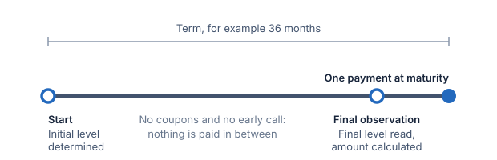
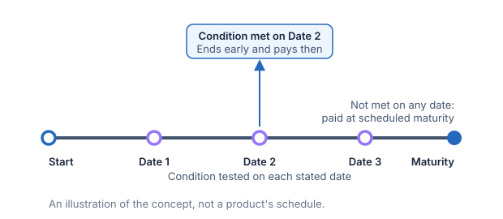

# Redemption behaviour

Redemption describes how and when a note ends, and which amount it pays when it
does: the maturity payoff, or the call amount. The maturity payoff is the amount
the payoff rules give from the underlier's final level; a call amount is a fixed
term of the early redemption itself. A call pays principal plus the call amount, and
the payoff's features (participation, buffer, cap, floor, protection) do not apply
to it.

## Bullet redemption

In this book's synthetic bullet note, there is one payment at scheduled
maturity and no early call. This example pays no coupons along the way, though
a bullet note can ([Coupons](20-coupons.md)). The payment
can be above, at, or below principal, depending on the maturity payoff rules.

For example, a three-year note with principal of 1,000 and 100% upside
participation pays 1,200 at maturity if its measured underlier return is +20%.
The participation explains the extra 200. Bullet redemption explains when the
1,200 is due.



## Early redemption

Some notes can end before scheduled maturity. An autocall is triggered
automatically by a condition in the terms; an issuer call gives the issuer a
right to redeem under stated terms. These are distinct from bullet redemption.
Their payment amounts and observation conditions must be read from the contract.
In SPIRe a call pays principal plus the call amount, and the reviews that can
call come from the product's review schedule. If no review calls, the note
reaches its end and pays the maturity payoff. SPIRe models the autocall and the issuer call: [Reviews and early redemption](19-reviews-and-early-redemption.md)
explains the reviews, the trigger, the call amount, a trigger that steps, a call on the final review, and an issuer call, which is the issuer's choice in a scenario.



Apart from an autocall or an issuer call, SPIRe's examples calculate only the scheduled maturity
payoff. They do not assume that an early sale or withdrawal would receive the
same amount.

## Adjustment factor

Any redemption can state an adjustment factor: a number the final level is
multiplied by before the maturity payoff reads it. The return the payoff then
reads is:

```text
Adjusted return = final level × adjustment factor ÷ initial level − 1
```

The factor moves the point where the holder gets principal back. With principal
of 1,000, 100% participation in both directions and an initial level of 100:

| Final level | Factor 100% | Factor 99.35% | Factor 101% |
| ---: | ---: | ---: | ---: |
| 120 | 1,200.00 | 1,192.20 | 1,212.00 |
| 100 | 1,000.00 | 993.50 | 1,010.00 |
| 80 | 800.00 | 794.80 | 808.00 |

At 99.35% the underlier must rise about 0.65% before principal comes back. At
101% principal comes back after a fall of about 0.99%. At 100% the factor changes
nothing, and a product that states none has a factor of 100%.

The factor changes the maturity payment only. A call pays principal plus the call
amount, a coupon pays its own rate, and a review reads the underlier's own level,
whatever the factor. SPIRe does not combine a factor other than 100% with a
buffer, a barrier or a digital return, because each tests the final level and it
is not settled whether that test reads the level before or after the factor. It
does not combine one with delivery either.

## Related concepts

Term gives the scheduled length. Determination selects the observations used
in the calculation. A final observation may precede the payment date: observing
a level and paying an amount are separate events.
