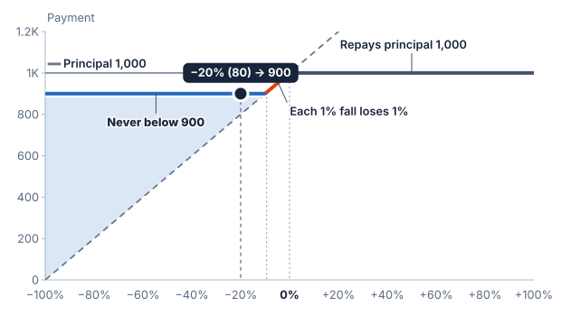

# Principal protection

Principal protection sets a contractual minimum payment at maturity as a
percentage of principal. Full protection is 100%; a 90% floor leaves up to
10% of principal exposed to the payoff's losses.

## A synthetic floor

Take principal of 1,000, 100% downside participation, and 90% protection.
There is no buffer or barrier.

- A 5% fall calculates 950, above the 900 floor: payment is 950.
- A 20% fall calculates 800, below the floor: payment is 900.
- A 50% fall calculates 500: payment is still 900.

The floor is not added to the participated payment. The larger of the two
amounts is paid. With 100% protection, downside participation cannot reduce
the maturity payment below principal.

## Protection and buffers

A floor limits the total contractual loss. A buffer removes an initial portion
of the underlier's fall before calculating a loss. These are different rules
and can produce very different payments for small and large falls.

## In the builder

The [Capped principal-protected note](https://sthotakura.github.io/spire/?example=capped-principal-protected-note) has
100% protection, 100% of a rise and a 20% cap, over 33 months. It pays between 1,000 and 1,200 at maturity: a 5% rise
pays 1,050, and any fall pays 1,000.

## What the promise covers

Protection in this example applies at maturity. It does not determine a resale
price before maturity, preserve purchasing power, or remove issuer credit
risk. [FINRA's explanation of principal protection](https://www.finra.org/investors/insights/structured-notes-principal-protection)
describes these contractual and credit distinctions.
