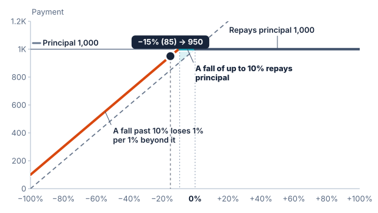

# Buffer

A buffer absorbs the first portion of an underlier's fall. In the form used
here, downside participation applies only to the fall beyond that portion.

## A 10% buffer

Assume principal of 1,000, initial level of 100, a 10% buffer, and 100%
downside participation. There is no absolute return or protection floor.

```text
At final level 95: a 5% fall is within the buffer; payment = 1,000
At final level 85: a 15% fall leaves 5% beyond it; payment = 950
At final level 50: a 50% fall leaves 40% beyond it; payment = 600
```

The buffer continues to remove the first 10% even on a large fall. A final
level of zero gives a 90% counted loss and a payment of 100 in this example.



## Rate matters

The downside rate applies after removing the buffer. With a 150% rate, a 15%
fall and 10% buffer produce a 7.5% loss, giving 925. Products with other loss
rates can have different maximum losses even when their buffers are identical.

## In the builder

The [Capped buffered note](https://sthotakura.github.io/spire/?example=capped-buffered-note) has a 15% buffer, and a
downside rate of 1 ÷ 0.85 ≈ 1.1765, so that a fall to zero loses the whole 1,000. Its upside is 140% of a rise, capped
at 19.04%, so the most it pays is 1,190.40 at 1,000 of principal. At a final level of 75, the 25% fall leaves 10% beyond the
buffer, and 10% × 1.1765 ≈ 11.76% is lost: the payment is about 882.35.

## Buffer, barrier, and floor

A buffer removes an initial portion of loss. A barrier decides whether the
whole fall counts. A floor limits the final payment's loss. [FINRA compares
buffers and barriers](https://www.finra.org/investors/insights/structured-notes-principal-protection)
using a 10% buffer and a 50% fall.

The buffer is measured from the determined initial level. In this example it
is tested against the final determined level, rather than intermediate prices.
