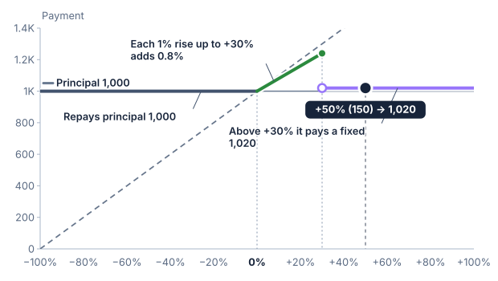
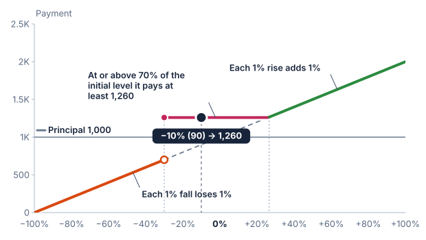
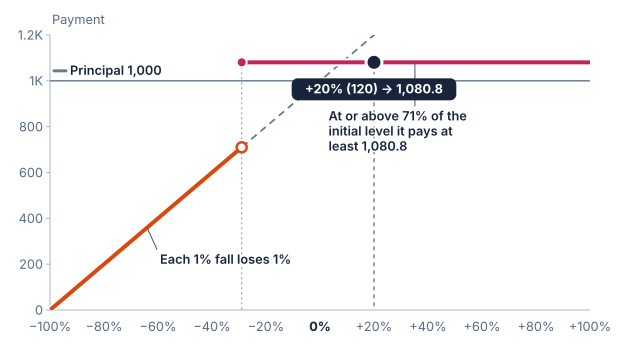

# Barrier

A barrier is a threshold that controls whether another rule applies. This book
names each barrier after the participation it controls. The downside barrier
switches downside participation on when the underlier is observed strictly
below the threshold. An upside barrier switches upside participation off when
the underlier is observed strictly above it. A barrier can be observed on the
final observation date only, or on every close from pricing to that date. The
first sections use the final level; the last section observes every close.

Practitioners call a barrier that switches a feature on a knock-in barrier and
one that switches it off a knock-out barrier. The downside barrier here is a
knock-in barrier, and the upside barrier is a knock-out barrier.

## A final-observation barrier

Assume principal of 1,000, initial level of 100, 100% downside participation,
and a barrier at 70% of the initial level. There is no protection floor or
absolute-return feature.

- Final level 80 is above the barrier: payment is 1,000.
- Final level 70 is exactly at the barrier: payment is 1,000.
- Final level 69 is below it: the whole 31% fall counts and payment is 690.
- Final level 50 gives payment of 500.


Equality matters. This example treats the barrier as breached only below 70.
A small move from 70 to just below 70 produces a large drop in payment.
A [public barrier note](https://www.sec.gov/Archives/edgar/data/19617/000121390026049358/ea0288297-01_424b2.htm)
illustrates the inclusive repayment threshold and whole-fall loss below it.

## Contrast with a buffer

A 30% buffer would pay 990 at final level 69, because only the 1% fall beyond
the buffer counts. The 70% barrier pays 690 because none of the fall is
deducted once breached.

## An upside barrier

A barrier can also end a feature. An upside barrier sits above the initial
level. Upside participation applies while the determined final level is at or
below it. Above it, participation ends and the holder receives a fixed amount
instead: a rebate, stated as a return on principal. A note may have no rebate,
in which case principal is repaid. The rebate is paid once, at maturity. It is
not a coupon, which would be a series of payments over the term.

Assume principal of 1,000, initial level of 100, 80% upside participation, an
upside barrier at 130% of the initial level, a 2% rebate, and 100% principal
protection. There is no downside participation.

```text
Final level 150 (+50%): barrier reached; payment = 1,000 × (1 + 2%) = 1,020
Final level 131 (+31%): barrier reached; payment = 1,020
Final level 130 (+30%): at the barrier, not reached; 1,000 × (1 + 80% × 30%) = 1,240
Final level 129 (+29%): not reached; 1,000 × (1 + 80% × 29%) = 1,232
Final level 120 (+20%): not reached; 1,000 × (1 + 80% × 20%) = 1,160
Final level 100 (0%): not reached; payment = 1,000
Final level 80 (−20%): not reached; no downside participation, so 1,000
```

The largest payment is at the barrier: a final level of 130 pays 1,240. Just
above it the payment drops to 1,020, so a higher final level can pay less.
Without a rebate, the first two rows would pay 1,000.



This example treats a final level exactly at 130 as not reaching the barrier,
as the downside barrier above treats a level exactly at its threshold. One
public note tests its upper barrier the same way, as strictly greater than.
Each product states its own rule, so check the equality in the contract.

Public educational material describes notes with this shape, often called
shark fin notes ([Hubbis](https://www.hubbis.com/article/swimming-with-sharks-capital-protected-structured-solutions-for-uncertain-times);
[my-structured-products.com](https://www.my-structured-products.com/index.php/know-how/capital-guarantee/36-shark-notes)).
Those descriptions observe the barrier on every trading day. This example reads
only the final level, so it describes a different contract; the next section
observes every close.

## Observing a barrier on every close

Many public notes observe a barrier on every trading day, using closing levels,
from the pricing date to the final observation date. The barrier is then reached
if any close crosses it, and it stays reached even if the underlier later
recovers. One daily-monitored note has a knock-in event "if the closing level of
either Index on any eligible trading day during the observation period is less
than its threshold level" ([SEC
424B2](https://www.sec.gov/Archives/edgar/data/72971/000138713119008969/wfcr1924-424b2_112119.htm)).
Another note watches both sides: its event occurs if, on any day in the period,
the closing level "is greater than the Upper Barrier or less than the Lower
Barrier", and the holder then receives a fixed return on principal whatever the
final level ([SEC
424B2](https://www.sec.gov/Archives/edgar/data/19617/000161577418007603/s111907_424b2.htm)).
That note pays the absolute value of the underlier's return on a rise as well as
a fall until the event, which the [Absolute return
chapter](13-absolute-return.md) covers.

SPIRe states this as the barrier's observation, `daily-close`. A scenario then
needs one more number than the final level: the lowest close for a downside
barrier, or the highest close for an upside barrier. Whether any close crossed
the threshold is the same as whether that extreme close did, so no list of
daily levels is needed. This reference assumes the initial level is the close
on the pricing date, which is never past either kind of barrier, so the start
of the period changes nothing.

Take the downside barrier above: principal of 1,000, initial level of 100, a
barrier at 70%, 100% downside participation, and no protection. The barrier is
reached only by a close strictly below 70.

```text
Final  Lowest  Barrier   Payment         Payment observed
level  close   reached?  observed daily  on the final date
100    65      yes       1,000           1,000
80     80      no        1,000           1,000
80     65      yes         800           1,000
65     65      yes         650             650
```

The third row is what daily observation adds. The underlier recovered to 80,
but it closed at 65 earlier, so the whole 20% fall counts. Observed on the
final date, the same note pays 1,000. In the first row the barrier was reached
but there is no fall left to count, so nothing is deducted.


Now take the upside barrier above: 80% upside participation, a barrier at 130%,
a 2% rebate, and 100% principal protection. The barrier is reached by any close
above 130.

```text
Final  Highest  Barrier   Payment         Payment observed
level  close    reached?  observed daily  on the final date
120    125      no        1,160           1,160
120    135      yes       1,020           1,160
150    150      yes       1,020           1,020
90     135      yes       1,020           1,000
```

In the second row a single close at 135 ended participation, so the rebate
replaces the 16% gain although the final level is below the barrier. In the
last row the rebate is paid although the underlier fell back below the initial
level. This is the behaviour public descriptions give for a shark fin note: the
rebate is paid once the barrier is reached, whatever the final level.

Both barriers can be observed on every close on one note. Take the downside
barrier at 70% with 100% downside participation, and the upside barrier at 130%
with 80% upside participation, with no rebate and no protection:

```text
Final level 100, no close beyond a barrier: payment = 1,000
Final level 120, highest close 120: 1,000 × (1 + 80% × 20%) = 1,160
Final level 120, highest close 135: the upside ended; payment = 1,000
Final level 90, lowest close 90, highest close 135: upside ended, downside barrier held; payment = 1,000
Final level 90, lowest close 65, highest close 135: upside ended, the whole 10% fall counts; payment = 900
Final level 65, lowest close 65, highest close 135: payment = 650
```

With a 2% rebate, the third and fourth examples pay 1,020, the fifth pays 920
(the rebate of 2% less the 10% fall), and the sixth pays 670. The two sides do
not cancel or override each other: each is read on its own and the terms are
added.

Assumptions and limits of this version:

- Only closing levels count. Intraday levels, and monitoring on other schedules
  such as weekly, are not modelled.
- The lowest and highest close are hypothetical scenario inputs, not terms of
  the product. A close cannot be below the lowest of the initial level and the
  levels the final level is read from, or above the highest of them.
- A daily barrier is available on a single underlier with a fixed initial level.
  It is not combined with lookback or a basket. Nor is a daily downside barrier
  combined with the absolute return on a fall, which the public trigger note
  reads on the final date. Absolute return in both directions is a separate
  payoff that carries its own daily barriers, described in the
  [Absolute return chapter](13-absolute-return.md).
- A daily upside barrier may be combined with downside participation, and each
  side keeps its own rule. An upside barrier reached on any close ends the upside,
  and pays the rebate if there is one, whatever the final level. The downside
  participation still reads the final return. With a rebate, the note can pay the
  rebate and a downside loss together. This is a combination of two parts that
  are each defined on their own, rather than a copy of one public note.
- The test is the same as above: a downside barrier is reached strictly below
  the threshold and an upside barrier strictly above it, as the two-sided note
  above tests its upper barrier. A close exactly at either barrier does not
  reach it. Each contract states its own equality rule.

## A digital return

A third kind of barrier belongs to a feature of its own. A digital return is a
fixed return on principal that is paid only while the determined final level is
at or above its own level, the digital barrier. It is called digital because the
condition is on or off: one cent below the barrier, none of it is paid.

Public notes write it as principal plus the greater of the digital return and
whatever the rest of the payoff would pay. So it acts as a floor that holds only
while the barrier is met. Below the barrier the payoff applies as if there were
no digital return.

Two things set it apart from the barriers above. It is **met at the level**: a
final level exactly at the digital barrier earns the digital return, where a
downside barrier is reached only strictly below its level. And the digital
barrier belongs to the digital return, not to downside participation. It is
read on the final date only, and its level can be at most 100% of the initial
level, so a barrier at the initial level itself can be written.

It is not absolute return. Absolute return pays a share of the size of a fall,
so the more the underlier falls, the more it pays, until the buffer or barrier
is passed, and it never pays on a rise. A digital return pays the same amount at
every level from its barrier up, a rise included.

Assume principal of 1,000, a worst-of basket of three indices that each start at
100, 100% upside participation, 100% downside participation, and a 26% digital
return with its barrier at 70% of each index's initial level. The worst index's
final level sets the payment.

```text
Worst index at 150 (+50%): participation pays 1,500, above the floor; payment = 1,500
Worst index at 126 (+26%): participation pays 1,260, the same as the floor; payment = 1,260
Worst index at 105 (+5%): barrier met; participation pays 1,050; the floor lifts it to 1,000 × (1 + 26%) = 1,260
Worst index at 100 (0%): barrier met; participation pays 1,000; payment = 1,260
Worst index at 90 (−10%): barrier met; participation pays 900; payment = 1,260
Worst index at 70 (−30%): at the barrier, met; participation pays 700; payment = 1,260
Worst index at 69.9 (−30.1%): below the barrier; the digital return is not paid; payment = 699
Worst index at 30 (−70%): below the barrier; payment = 300
```



The payment is the same 1,260 from the barrier up to the point where
participation overtakes it, and then follows the worst index. Below the barrier
it follows the worst index down. On the final date, the worst index at or above
70% is the same test as every index at or above 70% of its own initial level.

A digital return can also be the only thing a rise pays. Leave out upside
participation, and a rise leaves the payoff at principal, which the digital floor
then lifts to principal plus the digital return and no more. Assume principal of
1,000, a worst-of basket of two indices that each start at 100, 100% downside
participation, no upside participation, and an 8.08% digital return with its
barrier at 71%.

```text
Worst index at 140 (+40%): payment = 1,000 × (1 + 8.08%) = 1,080.80
Worst index at 90 (−10%): payment = 1,080.80
Worst index at 71 (−29%): at the barrier, met; payment = 1,080.80
Worst index at 70.99 (−29.01%): below the barrier; 100% of the fall counts; payment = 709.90
Worst index at 40 (−60%): payment = 400
Worst index at 0 (−100%): payment = 0
```



The most this note can pay is the digital return, however far the indices rise,
and a fall below the barrier is borne in full. The two examples follow the
payment rules of public notes, with synthetic indices, and are not valuations or
predictions. A digital return needs a note: it is not available on a deposit.
With a cap, its amount must be below the cap, so that participation can still
pay more than the floor.

A digital return can also sit beside participation, a buffer, a basket, averaging and a call. A two-year note on an equally
weighted basket of four stocks is called after one year if the basket is at or above its starting level, and pays
principal plus a 23.72% call premium. If it is not called, the final level is the average of five observed basket
levels. At or above the starting level the note pays the greater of a 47.44% digital return and 150% of the rise.
Between 85% and 100% it repays principal, and below 85% a 15% buffer applies at a loss rate of 1 ÷ 0.85, about
1.1765% for each 1% of fall. The digital barrier is at 100% of the starting level, and reads the averaged level.
With every stock observed at 120 on each date the note pays 1,474.40, because 150% of a 20% rise is only 30%; at 140
it pays 1,600. At 99.99 it pays 1,000, at 80 it pays 941.18, and at 0 it pays nothing.

One further shape is not modelled here. A public five-year note on the worst of two metal funds pays a digital
payment of 96.5% if both are at or above their starting values, and adds 150% of the rise beyond 196.5% of the
starting value. It repays principal between 80% and 100%, and loses one for one below 80%. The digital payment and
the two barriers fit the reference, but participation that starts at a level above the initial level is not a
feature of it, so the note is not a sample.

## In the builder

The [Capped barrier note](https://sthotakura.github.io/spire/?example=capped-barrier-note) has a final-date barrier at
80% of the initial level over 12 months, with 100% of a rise capped at 11.25%. A 5% rise pays 1,050, and a rise of 20%
pays 1,112.50. A fall to 85 pays 1,000, because the barrier is not reached; a fall to 70 reaches it, and the whole
30% fall counts: the payment is 700.

The [Worst-of leveraged barrier note](https://sthotakura.github.io/spire/?example=worst-of-leveraged-barrier-note)
reads the worst of three indices over 42 months, with 141.5% of a rise and no cap, and the same final-date barrier at 80%.
Each index starts at 100. If the worst ends at 110, the note pays 1,141.50, whatever the other two did. If the worst
ends at 85 it pays 1,000; at 70 it reaches the barrier, and the whole 30% fall counts: the payment is 700. On the final
date, the worst index below 80% is the same test as any one index below 80% of its own initial level.

The [Worst-of barrier digital note](https://sthotakura.github.io/spire/?example=worst-of-barrier-digital-note) is the
first example above, over 36 months. The
[Worst-of fixed-return barrier note](https://sthotakura.github.io/spire/?example=worst-of-fixed-return-barrier-note) is
the second, over 13 months. In the builder, a digital return is added from the Add feature menu, and its barrier sits
beneath it in the outline.

The [Autocallable basket note with a buffer and a digital return](https://sthotakura.github.io/spire/?example=autocallable-basket-note-with-buffer-and-digital-return)
is the two-year basket note.
