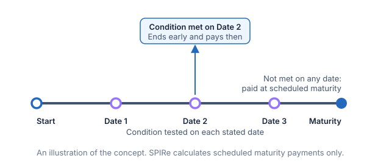

# Reviews and early redemption

Some products are tested on a series of dates through their life, not only at the end. A **review** is one of those dates: the underlier is read, a condition is checked, and something may happen. The simplest thing that can happen is that the product ends early. This chapter explains the reviews of a product and the automatic early redemption, the autocall, that the reference models.

## Reviews

A review schedule says how often a product is reviewed. In public pricing supplements the reviews are listed as dates, roughly monthly or quarterly. The reference models them as a frequency and a count: the reviews are evenly spaced through the term and numbered from 1, and the last review is the end of the term.

A 12-month term reviewed monthly has 12 reviews. A 36-month term reviewed quarterly has 12. The term must hold a whole number of periods: an 18-month term cannot be reviewed annually.

Nothing is stated about calendar dates. The issue date, the dates payments are made and the maturity date belong to issuing the product, and the reference leaves them out.

## Autocall

An **autocall** is automatic early redemption. On each review before the last, if the underlier is at or above the **trigger**, the product ends at once. It repays principal plus the **call amount**, and nothing more is paid. If no review before the last reaches the trigger, the product runs to the end of its term and pays its payoff as a bullet product does.

Three terms describe it:

- the **trigger**, a level as a share of the initial level, such as 100%;
- the **call amount**, paid above principal when the product is called, as a share of principal, such as 8%;
- the **review frequency**, which sets how many reviews there are.

The trigger is read at or above: a level exactly at it calls the product. By default the last review is not a call. It is the end of the term, so the payoff reads the final level there, as it does for any product. A product can also be set so that the last review is a call too, as described below.

## Worked example

A synthetic note with principal of 1,000, a term of 12 months, monthly reviews, a trigger of 100%, a call amount of 8%, an initial level of 100 and 100% downside participation. A rise is not paid, so beyond a call the note pays principal when the underlier ends at or above its initial level.

| Scenario | What happens | Months | Payment |
| :--- | :--- | ---: | ---: |
| The level is 100 on review 1 | Called on review 1: principal plus 8% | 1 | 1,080 |
| Below 100 on reviews 1 to 6, then 102 on review 7 | Called on review 7: principal plus 8% | 7 | 1,080 |
| Below 100 on every review, then ends at 110 | Not called. The payoff pays principal on a rise | 12 | 1,000 |
| Below 100 on every review, then ends at 70 | Not called. Downside participation: 1,000 × (1 − 30%) | 12 | 700 |

The call amount is the same whenever the product is called, so being called on review 7 pays no more than being called on review 1. A flat amount is a simplification. Some public notes pay more the longer they last, and the reference does not model that.

The payoff chart for a product with an autocall shows what it would pay if held to the end of its term, since that is what is read from the final level. The review table shows when it ends early.

## A trigger that steps down

A trigger can fall as the product ages, so that a product that has not recovered becomes easier to call. The **trigger step-down** is how far the trigger falls on each review after the first, as a share of the initial level. A trigger of 100% with a step-down of 5% is 100% on review 1, 95% on review 2, 90% on review 3, and 75% on review 6. A step-down of zero keeps one trigger for every review. The trigger must stay above zero on the last review that is tested.

## A call amount for each year

The call amount can be paid in one of two ways. **Each call** pays the same amount whenever the product is called, as in the table above. **Each year elapsed** pays the amount for every year the product has lasted, so the longer it runs, the more a call pays. With 10% for each year and semi-annual reviews, a call after six months pays 5% above principal, after a year 10%, and after three years 30%. The time elapsed is the number of months to the review, divided by 12.

## A call on the final review

The last review is the end of the term. By default it pays the payoff. A product can instead treat it as a call too: a final level at or above the trigger on the last review pays principal plus the call amount, in place of the payoff, and a final level below it pays the payoff. The payment is made at maturity, so the product lasts the full term either way. The trigger on the last review is the stepped-down trigger, such as 75%.

This makes the end of the product pay differently from a product without it. A final level between the last trigger and the initial level pays principal plus the call amount, where the payoff alone could pay only principal.

### A second worked example

A synthetic note with principal of 1,000, a term of 3 years and reviews every six months, so six reviews. The trigger starts at 100% and steps down 5% a review, to 75% on review 6, which is also a call. A call pays 10% for each year elapsed. The payoff is a downside barrier at 50% of the initial level, read on the final date with 100% downside participation: it repays principal unless the final level is below 50%, and then it pays the fall. The initial level is 100.

| Scenario | What happens | Months | Payment |
| :--- | :--- | ---: | ---: |
| The level is 100 on review 1 | Called: trigger 100%. Principal plus 10% × 0.5 year | 6 | 1,050 |
| Below the trigger on reviews 1 and 2, then 90 on review 3 | Called: trigger 90%. Principal plus 10% × 1.5 years | 18 | 1,150 |
| Below the trigger on reviews 1 to 5, then 75 on review 6 | Called: trigger 75%. Principal plus 10% × 3 years | 36 | 1,300 |
| Below the trigger on reviews 1 to 5, then 70 on review 6 | Not called. Above the barrier, so the payoff repays principal | 36 | 1,000 |
| Below the trigger on reviews 1 to 5, then 40 on review 6 | Not called. Below the barrier, so the payoff pays the fall: 1,000 × 40% | 36 | 400 |

The payoff chart for a product whose last review is a call shows the payoff alone. Above the last trigger the final review calls the product instead, and the review table and the calculation show it.

## Underliers and other features

- **A basket** is read as its basket level. For a worst-of basket that is the worst performing asset's level, so one asset below the trigger holds the call back. The reader states the level of each asset on each review, and the basket level is worked out from them by the basket's rule.
- **Averaging** is allowed. The averaging dates that set the final level are not tied to the review dates, so the final level is an average of the levels a reader states, not of the reviews. When the last review is a call, the averaged final level is the one tested on it.
- **Lookback** is not available with an autocall, because the lookback dates are not tied to the review schedule.
- **A barrier observed on every close** is not available with an autocall: a called product ends before the observation period does, and the single lowest or highest close a scenario states cannot say how far the product got. A barrier read on the final date is available.
- **Barrier absolute return** is not available with an autocall, because its barriers are observed on every close.

## Assumptions and sources

- The calls and reviews follow public auto-callable notes, such as an auto-callable contingent interest note whose automatic call can occur from a later review ([JPMorgan Chase Financial Company LLC, 424B2](https://www.sec.gov/Archives/edgar/data/19617/000121390026108339/ea0308243-01_424b2.htm)), and a step-down trigger autocallable note whose call threshold falls on each observation date, whose call return grows with time, and whose final valuation date is also tested for a call ([UBS AG, 424B2](https://www.sec.gov/Archives/edgar/data/1114446/000183988225047092/ubs_424b2-26373.htm)).
- The Swiss Structured Products Association describes an autocall as an obligation to repay early when the underlyings are above the trigger on a predetermined observation date, and a softcall as an issuer option on such dates ([SSPA](https://sspa.ch/en/lab/)).
- The reviews are evenly spaced whole numbers of months. Public notes list dates that shift with weekends and holidays.
- The call amount is either one flat amount, or an amount for each year elapsed. Public notes that pay more the longer they last state it as a rate and a table of call prices; the reference states the rate, and works out the price for each review.
- The trigger falls by the same step on each review. Public notes list a threshold for each date, which can step by uneven amounts.
- A final review that is a call is tested on the final level the payoff reads.
- Postponement for market disruptions is not modelled.

## What is not modelled

Contingent coupons, memory, a period at the start in which the product cannot be called, a trigger that steps by uneven amounts, an issuer call and a schedule of payments. Each would be added on top of the reviews described here.

## Related concepts

Redemption behaviour introduces bullet and early redemption. Term gives the scheduled length that the reviews divide. Determination selects the observations the payoff reads at the end. Barrier explains observation on the final date and on every close.
