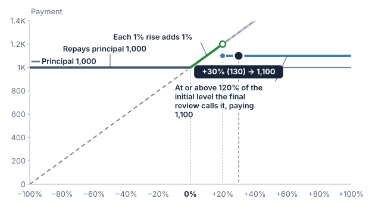

# Reviews and early redemption

Some products are tested on a series of dates through their life, not only at the end. A **review** is one of those dates: the underlier is read, a condition is checked, and something may happen. The simplest thing that can happen is that the product ends early. This chapter explains the reviews of a product, the automatic early redemption, the autocall, and the early redemption at the issuer's option, the issuer call, that the reference models.

## Reviews

A review schedule says how often a product is reviewed. Public notes call these dates "observation dates" or "review dates". The reference calls them reviews to keep them apart from the observations that set the initial and final levels, such as the dates averaged into a final level, and from a barrier observed on every close. In public pricing supplements the reviews are listed as dates, roughly monthly or quarterly. The reference models them as a frequency and a count: the reviews are evenly spaced through the term and numbered from 1, and the last review is the end of the term.

A 12-month term reviewed monthly has 12 reviews. A 36-month term reviewed quarterly has 12. The term must hold a whole number of periods: an 18-month term cannot be reviewed annually.

The reference starts a term with a frequency that keeps the review table readable: semi-annual above a year, quarterly from six months to a year, and monthly below six months, passing over any that does not divide the term into whole periods. The reader can choose another. Public notes can be reviewed more often, even weekly or daily; the reference offers monthly to annual.

Nothing is stated about calendar dates. The issue date, the dates payments are made and the maturity date belong to issuing the product, and the reference leaves them out.

## Autocall

An **autocall** is automatic early redemption. On each review before the last, if the underlier is at or above the **trigger**, the product ends at once. It repays principal plus the **call amount**, and nothing more is paid. If no review before the last reaches the trigger, the product runs to the end of its term and pays its payoff as a bullet product does.

Three terms describe it, and the sections below add three more:

- the **trigger**, a level as a share of the initial level, such as 100%;
- the **call amount**, paid above principal when the product is called, as a share of principal, such as 8%;
- the **review frequency**, which sets how many reviews there are.

The others are a **trigger step**, which moves the trigger on each review, whether the call amount is paid for each call or for each year elapsed, and whether the last review is a call too.

The trigger is read at or above: a level exactly at it calls the product. By default the last review is not a call. It is the end of the term, so the payoff reads the final level there, as it does for any product. A product can also be set so that the last review is a call too, as described below.

## Worked example

A synthetic note with principal of 1,000, a term of 12 months, monthly reviews, a trigger of 100%, a call amount of 8%, an initial level of 100 and 100% downside participation. A rise is not paid, so beyond a call the note pays principal when the underlier ends at or above its initial level.

| Scenario | What happens | Months | Payment |
| :--- | :--- | ---: | ---: |
| The level is 100 on review 1 | Called on review 1: principal plus 8% | 1 | 1,080 |
| Below 100 on reviews 1 to 6, then 102 on review 7 | Called on review 7: principal plus 8% | 7 | 1,080 |
| Below 100 on every review, then ends at 110 | Not called. The payoff pays principal on a rise | 12 | 1,000 |
| Below 100 on every review, then ends at 70 | Not called. Downside participation: 1,000 × (1 − 30%) | 12 | 700 |

The calculation also states the annualised return, which reads the months the product lasted and not the term. Called on review 7 after 7 months, the 8% is (1,080 ÷ 1,000)^(12 ÷ 7) − 1, or 14.1% a year. Called on review 1 it is the same 8% earned in one month, which annualises to 151.8% a year. A product that ran to the end of its term annualises over the whole term. The steps for the payoff are still shown after a call, under a heading that says they are what it would have paid at maturity, and none of it is paid.

In this example the call amount is the same whenever the product is called, so being called on review 7 pays no more than being called on review 1. That is the flat form. Some public notes pay more the longer they last, which the section on a call amount for each year describes.

The payoff chart for a product with an autocall shows what it would pay if held to the end of its term, since that is what is read from the final level. The review table shows when it ends early. In the reference, the table has a column for the level each review needs and one for each level the reader states. Named paths, such as called on the first review, called late after a fall, never called and ending up, or never called and ending down, fill the review levels in one step. A path called before the last review leaves the final level alone, because a product that ended early never reaches it. The final level is dimmed then, since it no longer sets the payment, but it still sets the dot on the chart and the comparison with what the payoff would have paid at maturity.

## A trigger that steps

A trigger can change as the product ages. The **trigger step** is how much the trigger changes on each review after the first, as a share of the initial level. A negative step lowers it, so that a product that has not recovered becomes easier to call: a trigger of 100% with a step of −5% is 100% on review 1, 95% on review 2, 90% on review 3, and 75% on review 6. A positive step raises it, so each review asks for more than the one before: 100% with a step of +5% is 105% on review 2 and 110% on review 3. A step of zero keeps one trigger for every review. The trigger must stay above zero, and at most 200% of the initial level, on every review that is tested. The public note read for this chapter steps down; the reference allows a step up as the same idea in the other direction.

## A call amount for each year

The call amount can be paid in one of two ways. **Each call** pays the same amount whenever the product is called, as in the table above. **Each year elapsed** pays the amount for every year the product has lasted, so the longer it runs, the more a call pays. With 10% for each year and semi-annual reviews, a call after six months pays 5% above principal, after a year 10%, and after three years 30%. The time elapsed is the number of months to the review, divided by 12.

## A period with no calls

Some notes cannot be called at the start, even if the condition holds. One public note is reviewed monthly for a year but allows an automatic call only from the sixth review ([JPMorgan Chase Financial Company LLC, 424B2](https://www.sec.gov/Archives/edgar/data/19617/000121390026108339/ea0308243-01_424b2.htm)). The reference states it as a **non-call period**, a number of reviews at the start. A review in the period is read, but it cannot call, even when its level meets the trigger. A period of 0 reviews lets the product be called from the first review, as in the first example.

Take the first example with a non-call period of 5 reviews, so reviews 1 to 5 cannot call and the first call is on review 6.

| Scenario | What happens | Months | Payment |
| :--- | :--- | ---: | ---: |
| The level is 120 on reviews 1 to 5, below 100 on every later review, then ends at 110 | Reviews 1 to 5 cannot call, whatever the level. No later review reaches the trigger, so it runs to the end and the payoff pays principal | 12 | 1,000 |
| The level is 120 on reviews 1 to 5, then 100 on review 6 | Review 6 is the first that can call, and it is at the trigger: principal plus 8% | 6 | 1,080 |

The trigger is counted from review 1, not from the end of the period, so a trigger that steps down by 5% from 100% is 85% on review 4 whatever the period is. The period must leave at least one review that can call: at most the last but one, or the last when the final review is a call too. The reference does not model coupons, which the public note pays on every review including those in the period.

## A call on the final review

The last review is the end of the term. By default it pays the payoff. A product can instead treat it as a call too: a final level at or above the trigger on the last review pays principal plus the call amount, in place of the payoff, and a final level below it pays the payoff. The payment is made at maturity, so the product lasts the full term either way. The trigger on the last review is the trigger after any step, such as 75% after stepping down from 100%.

This makes the end of the product pay differently from a product without it. With a trigger that has stepped down, a final level between the last trigger and the initial level pays principal plus the call amount, where the payoff alone could pay only principal.

### A second worked example

A synthetic note with principal of 1,000, a term of 3 years and reviews every six months, so six reviews. The trigger starts at 100% and steps down by 5% a review (a step of −5%), to 75% on review 6, which is also a call. A call pays 10% for each year elapsed. The payoff is a downside barrier at 50% of the initial level, read on the final date with 100% downside participation: it repays principal unless the final level is below 50%, and then it pays the fall. The initial level is 100.

| Scenario | What happens | Months | Payment |
| :--- | :--- | ---: | ---: |
| The level is 100 on review 1 | Called: trigger 100%. Principal plus 10% × 0.5 year | 6 | 1,050 |
| Below the trigger on reviews 1 and 2, then 90 on review 3 | Called: trigger 90%. Principal plus 10% × 1.5 years | 18 | 1,150 |
| Below the trigger on reviews 1 to 5, then 75 on review 6 | Called: trigger 75%. Principal plus 10% × 3 years | 36 | 1,300 |
| Below the trigger on reviews 1 to 5, then 70 on review 6 | Not called. Above the barrier, so the payoff repays principal | 36 | 1,000 |
| Below the trigger on reviews 1 to 5, then 40 on review 6 | Not called. Below the barrier, so the payoff pays the fall: 1,000 × 40% | 36 | 400 |

The payoff chart draws what the product pays at the end of its term against the final level. When the last review is a call, the line jumps at the last trigger to principal plus the call amount, and a label says so. The chart does not show an earlier call, which ends the product before the final level is read.

### Seen against the final level: a shark fin

When the last review is the only call, the chart is a shark fin. Take a note with 100% upside participation, a 24-month term, a trigger of 120% on the last review and a call amount of 10%, with the last review as a call. A final level below 120% pays the rise, up to 1,200. At 120% and above the final review calls the note and pays 1,100, so the line climbs to the trigger and then drops to the call amount.

This is the same shape as an upside barrier with a rebate, where the call amount plays the part of the rebate. The difference is in the earlier reviews. An upside barrier is read once, so it is the whole story, while reviews before the last can also call the note, and a note that was never called on those reviews can still end at any level. The chart shows only the end of the term.

## An issuer call

An **issuer call** is the issuer's option to redeem a product early. An autocall is an obligation that follows from the underlier's level. An issuer call has no level test: on a review that can be called, the issuer may redeem the product in whole, and nothing in the terms says when it will. The Swiss Structured Products Association calls this a softcall ([SSPA](https://sspa.ch/en/lab/)).

The reference models it with three terms: the review frequency, a non-call period (the number of reviews at the start on which the issuer cannot call), and a call amount, paid above principal and stated as for an autocall, flat or for each year elapsed. The last review is the end of the term and is not a call. Because the issuer's decision is not a term of the product, a scenario states it: the review the issuer calls on, or that it does not call.

Two public notes show the shape. In a callable contingent interest note on three indices, "We, at our election, may redeem the notes early", on any interest payment date except the first five and the last, with no condition on the index level ([JPMorgan Financial, 424B2](https://www.sec.gov/Archives/edgar/data/19617/000121390023083784/ea165015_424b2.htm)). In an issuer callable yield note on the S&P 500, the issuer may call quarterly from a first call date, at its "sole option", and the call right is not tied to the index level ([BofA Finance, 424B2](https://www.sec.gov/Archives/edgar/data/1682472/000148105724004907/form424b2.htm)). Both have a non-call period at the start, which is why the reference reuses the one it has for an autocall.

### An example

A synthetic note with principal of 1,000, a term of 12 months, monthly reviews, a non-call period of 2 reviews, a call amount of 2%, an initial level of 100 and 100% downside participation. The issuer can call on reviews 3 to 11.

| Scenario | What happens | Months | Payment |
| :--- | :--- | ---: | ---: |
| The issuer does not call, and the level ends at 110 | The note runs to the end of its term. The payoff pays principal on a rise | 12 | 1,000 |
| The issuer does not call, and the level ends at 70 | Downside participation: 1,000 × (1 − 30%) | 12 | 700 |
| The issuer calls on review 5, and the level is 70 | Called: principal plus 2%. The level does not matter | 5 | 1,020 |

A call after 5 months that pays 2% above principal annualises to 4.87% a year, because the return is read over the months the product lasted, as for an autocall. With no call amount a call repays principal only and annualises to 0%.

### What the reference does not say

- **Why the issuer would call.** Neither public note says. The decision is the issuer's, outside the terms, so the reference leaves it to the reader to state and suggests no reason.
- **A premium.** Neither note pays one above principal and the coupon, so the call amount starts at zero. A call price above principal is coherent, and the reference allows it, but no public note read for this chapter states one.
- **Coupons.** The call price in both notes is principal plus that review's coupon when it was earned, and a call stops the remaining coupons. The reference has no coupons, so a call here repays principal and any call amount.
- **Notice and dates.** Both notes state a notice period and a payment date after the review. The reference has no calendar dates.
- **An issuer call and an autocall together** are not modelled. A product has one or the other.

An issuer call is not available with a barrier observed on every close or with barrier absolute return, for the reason an autocall is not: a called product ends before the observation period does. Lookback is allowed, since nothing is read on the reviews. Averaging is allowed, and the final level is read only if the issuer does not call.

## Underliers and other features

- **A basket** is read as its basket level. For a worst-of basket that is the worst performing asset's level, so one asset below the trigger holds the call back. The reader states the level of each asset on each review, and the basket level is worked out from them by the basket's rule.
- **Averaging** is allowed. The averaging dates that set the final level are not tied to the review dates, so the final level is an average of the levels a reader states, not of the reviews. When the last review is a call, the averaged final level is the one tested on it.
- **Lookback** is not available with an autocall, because the lookback dates are not tied to the review schedule.
- **A barrier observed on every close** is not available with an autocall: a called product ends before the observation period does, and the single lowest or highest close a scenario states cannot say how far the product got. A barrier read on the final date is available.
- **Barrier absolute return** is not available with an autocall, because its barriers are observed on every close.

## Assumptions and sources

- The calls and reviews follow public auto-callable notes, such as an auto-callable contingent interest note whose automatic call can occur from a later review ([JPMorgan Chase Financial Company LLC, 424B2](https://www.sec.gov/Archives/edgar/data/19617/000121390026108339/ea0308243-01_424b2.htm)), and a step-down trigger autocallable note whose call threshold falls on each observation date, whose call return grows with time, and whose final valuation date is also tested for a call ([UBS AG, 424B2](https://www.sec.gov/Archives/edgar/data/1114446/000183988225047092/ubs_424b2-26373.htm)).
- The Swiss Structured Products Association describes an autocall as an obligation to repay early when the underlyings are above the trigger on a predetermined observation date, and a softcall as an issuer option on such dates ([SSPA](https://sspa.ch/en/lab/)).
- The reviews are evenly spaced whole numbers of months. Public notes list dates that shift with weekends and holidays.
- The call amount is either one flat amount, or an amount for each year elapsed. Public notes that pay more the longer they last state it as a rate and a table of call prices; the reference states the rate, and works out the price for each review.
- The trigger moves by the same step on each review. Public notes list a threshold for each date, which can step by uneven amounts.
- A final review that is a call is tested on the final level the payoff reads.
- Postponement for market disruptions is not modelled.

## What is not modelled

Contingent coupons, memory, a trigger that steps by uneven amounts, a premium on an issuer call that a source states, notice periods, and a schedule of payments. Each would be added on top of the reviews described here.

## Related concepts

Redemption behaviour introduces bullet and early redemption. Term gives the scheduled length that the reviews divide. Determination selects the observations the payoff reads at the end. Barrier explains observation on the final date and on every close.
