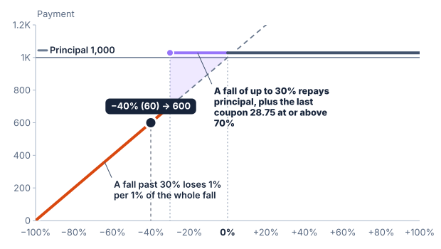

# Coupons

A **coupon** is a payment made to the holder during a product's life, on its reviews, separate from the repayment of principal. This chapter explains the coupon most public autocallable notes pay, the **contingent coupon**, and the **memory** feature that some of them add. The reference gives the coupon its own reviews, so it goes with any redemption: a bullet note, an autocall or an issuer call.

## A contingent coupon

A contingent coupon is paid on a review only if a condition holds. The condition is a **coupon barrier**: a level of the underlier, as a share of its initial level. On each review the level is compared with it. At or above the barrier, the coupon for that review is paid. Below it, the coupon is missed.

The condition is what makes the coupon contingent. A fixed coupon is paid on every date whatever the underlier does. A contingent coupon can pay on some reviews and not others, or on none.

A public note states the coupon as a rate a year and the amount paid on each review. One note pays "17.35% per annum, payable at a rate of 1.44583% per month" when its stock closes at or above 50% of its strike on a review ([JPMorgan Chase Financial Company LLC, 424B2](https://www.sec.gov/Archives/edgar/data/19617/000121390026045661/ea0286921-01_424b2.htm)). Another pays 11.50% a year, 2.875% a quarter, at or above 70% ([JPMorgan Chase & Co., 424B2](https://www.sec.gov/Archives/edgar/data/19617/000089109212004122/e49253_424b2.pdf)). The amount on each review is the rate a year times the months between reviews, divided by 12.

The reference states the coupon with three terms:

- the **rate**, a share of principal a year, such as 12%;
- the **coupon barrier**, a share of the initial level, such as 70%, read at or above;
- **memory**, on or off.

It is tested on its own **reviews**, a frequency such as monthly or quarterly, as the call's are. Each coupon review the product reaches is tested, including those in a call's non-call period, which cannot call but can pay a coupon, and the last review, which reads the final level. The coupon's reviews can be the same as the call's, and in the three notes above they are, but they need not be: a coupon can be reviewed monthly beside a quarterly call.

## Memory

Without memory, a missed coupon is lost. With memory it is remembered, and paid on the next review at or above the barrier, with that review's own coupon. The note at 50% above says that a review at or above the barrier pays, "in addition to the Contingent Interest Payment with respect to that Review Date, any previously unpaid Contingent Interest Payments for prior Review Dates". The note at 70%, from the same issuer, says a missed coupon "will not be accrued and subsequently paid". Memory is a term of the note, not part of what a contingent coupon is.

Memory does not change the condition. It only lets a missed coupon be paid late. If no later review meets the barrier, the remembered coupons are never paid.

## The coupon and the call

A coupon and an autocall test different levels. The call trigger is usually higher, such as 100% of the initial level, and the coupon barrier lower, such as 70%. A review at or above the barrier and below the trigger pays its coupon and the product continues. A review at or above the trigger calls the product, which repays principal plus that review's coupon, and with memory any remembered coupons, and ends. No later coupon is paid.

When the two have different reviews, the dates are taken in order of month. A coupon review that falls on the date of a call pays with the call. A call on a date that is not a coupon review pays principal and any call amount, and the coupons tested before it have been paid on their own dates. With a monthly coupon and a quarterly call, a call in month 6 pays the month 6 coupon with it; with a quarterly coupon and a monthly call, a call in month 4 pays no coupon, the month 3 coupon having been paid already.

In the public notes read for this chapter a call pays principal and the coupon and nothing more, so the call amount described in [Reviews and early redemption](19-reviews-and-early-redemption.md) is zero. The reference still allows a call amount beside a coupon, since the two are coherent together.

If the product is not called, the last review pays the maturity payoff, and its coupon if the final level is at or above the barrier.

The coupon barrier is its own level, apart from the trigger and from the downside barrier or buffer of the payoff. In the 70% note the coupon barrier and the downside barrier are both 70%. In the 50% note the downside barrier is lower, at 40%, so a final level between 40% and 50% repays principal and pays no coupon.

## Worked example

A synthetic note with principal of 1,000, a term of 12 months, monthly reviews and an initial level of 100. The coupon is 12% a year, so 10 a review, with a 70% barrier. The autocall has a 100% trigger, no call amount and a non-call period of 3 reviews. The payoff is 100% downside participation with a 60% downside barrier read on the final date.

| Review | Level | Barrier met | Paid with memory | Paid without memory |
| ---: | ---: | :--- | ---: | ---: |
| 1 | 95 | Yes | 10 | 10 |
| 2 | 65 | No | 0 | 0 |
| 3 | 102 | Yes; in the non-call period, so no call | 20 | 10 |
| 4 | 68 | No | 0 | 0 |
| 5 | 104 | Yes; called | 1,000 + 20 | 1,000 + 10 |

With memory the note pays 1,050 over five months, 50 of it in coupons. Without memory it pays 1,030. On review 3 the level is above the trigger, but the review is in the non-call period, so it pays its coupon and the note continues.

If the note is never called, the last review decides two things at once. Say the earlier coupons have been paid. A final level of 75 is above the downside barrier, so the payoff repays 1,000, and it is above the coupon barrier, so the last coupon of 10 is paid with it: 1,010, plus any remembered coupons. A final level of 55 is below the downside barrier, so the payoff pays 550, and it is below the coupon barrier, so the last coupon is missed and any remembered coupons are lost.

## Seen against the final level

The payoff chart draws what the product pays at the end of its term, if no earlier review called it, against the final level. With a coupon the line steps up at the coupon barrier by one coupon, the last review's own. The remembered coupons depend on the path, so they are not drawn; the review table and the calculation show them. The review table works each coupon out, such as 1,000 × 10% × 3/12 = 25 for a quarterly review, or 2 × 25 = 50 when a remembered coupon is paid with it.

The scenario table shows the same payment at the end of the term as the chart, with a column for the last coupon, and adds a row at the coupon barrier and one just below it, where the last coupon is missed. When the coupon barrier is at the level of a payoff barrier, the one row is marked as both.

When the coupon barrier equals the downside barrier, the two steps are at the same level and add up. With quarterly reviews over a year, an 11.50% coupon (28.75 a review) and both barriers at 70%, a final level just below 70 pays 699.90 and a final level of 70 pays 1,028.75, as the 70% note's table of payments shows.

## The calculation

The calculation lists the coupon on each review the product reached, then the call tests, then how it ended. A called product's total is what it paid on earlier reviews plus the call. A product that ran to the end adds the last coupon to the payoff payment, and then gives the total.

It does not give an annualised return when the product pays coupons. The return a year the reference gives for a single payment reads one amount at one date. Coupons arrive on many dates, and a figure that ignored when would mislead. The total paid and the **total return** are shown instead: what was paid less principal, as a share of principal, over the months the product lasted. In the worked example, called after five months with memory, the note pays 1,050 in all, a total return of 5% over 5 months. The total return is not a return a year, and a total return over 5 months cannot be compared with one over 3 years without saying so.

## Underliers and other features

- **A basket** is read as its basket level, as the call is. For a worst-of basket, the coupon is paid only if every asset is at or above the barrier, which is the worst asset at or above it. The note in [Reviews and early redemption](19-reviews-and-early-redemption.md) on two funds pays its coupon this way.
- **Averaging** is allowed. The last review reads the averaged final level, as the maturity payment does.
- **A trigger that steps down** below the coupon barrier can call the product on a review that misses its coupon. The reference then pays principal and any call amount, with no coupon on that review, and remembered coupons are lost. No public note read states this case.
- **A bullet note** with a coupon reads a level on each coupon review and nothing else, and pays the last coupon with its maturity payment.
- **An issuer call** with a coupon reads a level on each coupon review; the issuer's decision reads none. A call on a coupon review pays principal, any call amount and that review's coupon, as the issuer call notes in [Reviews and early redemption](19-reviews-and-early-redemption.md) do.
- **Lookback** is allowed, on the assumption that the lookback period ends before the first coupon review, as with an autocall. The coupon barrier is then a share of the lookback level.
- **A barrier observed on every close** is not available with a coupon, for the reason it is not with an autocall: the levels on the coupon reviews are closes that the one lowest or highest close a scenario states would have to agree with.

## Assumptions and sources

- The coupon, its barrier read at or above, memory and the call that pays principal plus the coupon follow three public auto-callable contingent interest notes: the 50% note with memory, the 70% note without it, and a note on two funds at 80% with memory ([JPMorgan Chase Financial Company LLC, 424B2](https://www.sec.gov/Archives/edgar/data/19617/000121390026108339/ea0308243-01_424b2.htm)).
- The coupon has its own schedule. The three contingent notes use one list of review dates for both; a fixed coupon note from another issuer lists its coupon payment dates apart from its call dates ([BofA Finance LLC, 424B2](https://www.sec.gov/Archives/edgar/data/70858/000148105723007689/form424b2.htm)). No contingent note read reviews its coupon on dates other than its calls, but a coupon and a call on their own schedules are coherent, and the reference allows it.
- The coupon on a review is the rate a year times the months between reviews, divided by 12. The reference does not round it; public notes state a rounded amount.
- The reviews are evenly spaced whole numbers of months, and payments are made at the review. Public notes pay a few days after.

## What is not modelled

A fixed coupon, a coupon barrier that steps, a coupon barrier set differently for each asset, an annualised return over payments made on several dates, and payment dates.

## Related concepts

Reviews and early redemption explains the schedule, the autocall and the non-call period the coupon reads. Barrier explains a level read on the final date, as the downside barrier at the end of the term is. Underliers explains how a basket level is read.
