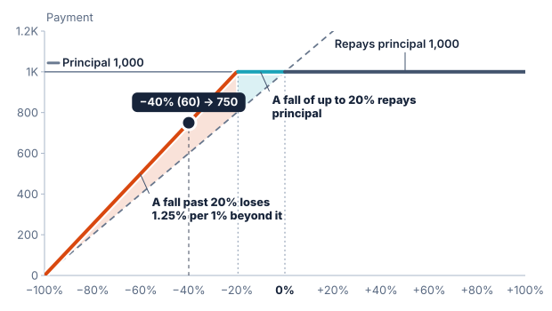

# Settlement

**Settlement** is how a product pays. In **cash settlement** the holder receives money. In **delivery**, also called physical settlement, the holder receives shares of the underlier in place of money.

Delivery does not change what the payment is worth on the final date. The number of shares is fixed when the product is priced, so after a fall the holder owns shares worth less than principal. It changes what the holder ends up owning: shares, with their price risk, and not a claim for money.

It is a term of the product, not of its legal form or its payoff. The payoff says how much is owed, and settlement says how that is paid.

## Where delivery applies

In the reverse convertibles read for this chapter, shares are delivered only where the holder bears a fall. All of these stay in cash, even on a product that delivers:

- a coupon
- a call
- a payment of principal or more
- a fall within a buffer, or one that ends at or above a barrier
- a fall paid as a gain
- a payment that a digital return's minimum sets

## How many shares

The count follows from terms the product already has:

```text
shares = principal × downside rate ÷ initial level
cash   = principal × (1 − downside rate × (1 − buffer))
```

With no buffer, the buffer in this formula is 0. On a worst-of basket the shares are of the worst asset, and the initial level is that asset's own.

Shares at the final level plus the cash always equal the payment. On a note of 1,000 on Synthetic Stock with an initial level of 100:

| Downside | Final level | Payment | Holder receives |
| :--- | ---: | ---: | :--- |
| Barrier at 45%, rate 1 | 60 | 1,000.00 | Cash |
| Barrier at 45%, rate 1 | 40 | 400.00 | 10 shares |
| No barrier or buffer, rate 1 | 95 | 950.00 | 10 shares |
| Buffer of 20%, rate 1 | 75 | 950.00 | 10 shares and 200.00 in cash |
| Buffer of 20%, rate 1.25 | 80 | 1,000.00 | Cash |
| Buffer of 20%, rate 1.25 | 60 | 750.00 | 12.5 shares |

The product's terms limit the rate. If rate × (1 − buffer) were above 100%, the cash would be negative and the holder would owe the issuer, so the reference rejects it.

## The classic form and the barrier form

A **reverse convertible** pays a fixed coupon, with no share in a rise. The Swiss Structured Products Association's map lists two forms, and they differ in when the holder starts to bear a fall:

- **Reverse convertible.** It has a **strike** and nothing else. At or above the strike the holder receives principal. Below it the holder receives shares, whatever happened during the term.
- **Barrier reverse convertible.** The holder receives principal unless the underlier has reached a barrier and ends below its initial level. The association's map says that touching the barrier makes it a reverse convertible.

On a note of 1,000 with an initial level of 100, comparing a strike at the initial level with a barrier at 80%:

| Final level | Classic, strike 100% | Barrier at 80% |
| ---: | ---: | ---: |
| 100 | 1,000.00 | 1,000.00 |
| 95 | 950.00, in shares | 1,000.00, in cash |
| 80 | 800.00, in shares | 1,000.00, in cash |
| 79 | 790.00, in shares | 790.00, in shares |

The classic form's loss starts at the strike, with no jump. The barrier form holds at principal and then drops. Below the barrier the two pay the same.

A classic strike is often below the initial level, and the count then divides by the strike: a strike of 80 on a note of 1,000 refers to 12.5 shares. The reference states such a strike with a buffer and a rate. A strike of 80% is a buffer of 20% at a rate of 1 ÷ 0.8, or 1.25, which pays principal down to the strike and then 1,000 × final level ÷ 80.



The chart draws the value of the payment. Below the strike, where shares are delivered, that is their value on the final date. The barrier form is drawn in the [Barrier](12-barrier.md) chapter.

## In the builder

- The [Worst-of reverse convertible](https://sthotakura.github.io/spire/?example=worst-of-reverse-convertible) is modelled on a Vontobel note: 33 months, the worst of three stocks, a fixed coupon of 10% a year, and a strike of 80%.
- The [Autocallable worst-of barrier reverse convertible](https://sthotakura.github.io/spire/?example=autocallable-worst-of-barrier-reverse-convertible) is modelled on a Credit Suisse note: 24 months, the worst of two stocks, a fixed coupon of 14% a year, an autocall from month 6, and a 45% barrier on the final date.

## Assumptions

- The reference delivers stocks only, as one stock or a worst-of basket of stocks. An index cannot be delivered, and a note on one pays cash even under the name "reverse convertible".
- The value shown is on the final date. Public notes deliver a few days after it, and a holder of shares bears any move in their price from then on.
- The final level has to be a close, so delivery is not combined with an averaged final level. It is not combined with principal protection either, since no public note read has both.

## What is not modelled

Rounding down to whole shares, with cash for the fraction at the final level; an issuer's right to pay cash instead of shares; adjustments to the count for events such as a stock split; delivering shares of a fund; and a product that delivers on a rise, such as a mandatorily exchangeable note. None of the first three changes the value on the final date.

## Related concepts

[Buffer](11-buffer.md) and [Barrier](12-barrier.md) decide when the holder bears a fall. [Underliers](05-underliers.md) explains the worst-of basket. [Coupons](20-coupons.md) explains the fixed coupon. [Structured products](01-what-is-a-structured-product.md) explains the names.
